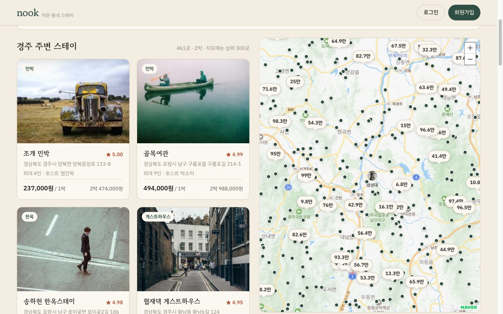
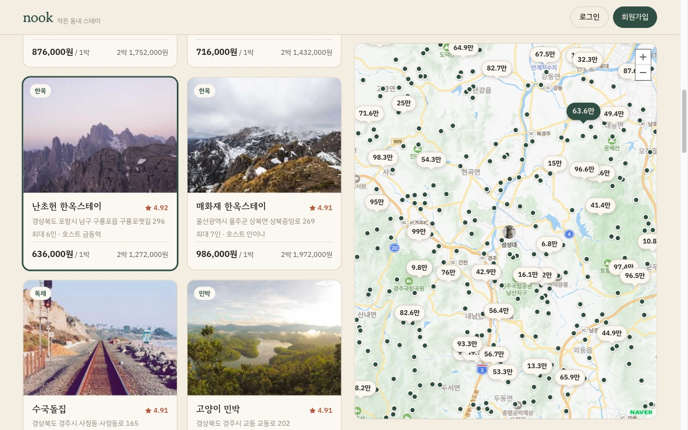
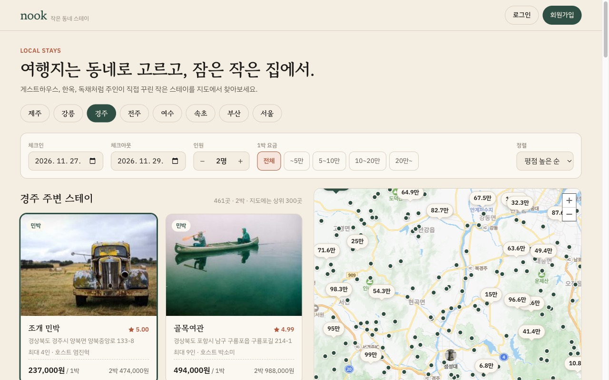

<div align="center">

# nook

**여행지는 동네로 고르고, 잠은 작은 집에서.**

게스트하우스, 한옥, 독채, 민박처럼 주인이 직접 꾸린 작은 스테이를 지도에서 찾는 서비스

[](https://react.dev/)
[](https://www.typescriptlang.org/)
[](https://vite.dev/)
[](https://nestjs.com/)
[](https://www.mysql.com/)
[](https://redis.io/)
[](https://navermaps.github.io/maps.js.ncp/)

</div>

<br />

<div align="center">
  
</div>

<br />

<div align="center">

**[📖 백엔드 의사결정 위키](docs/wiki/Home.md)**

</div>

<br />

## 목차

- [기획 배경](#기획-배경)
- [nook이 하는 일](#nook이-하는-일)
- [주요 기능](#주요-기능)
- [시작하기](#시작하기)
- [아키텍처](#아키텍처)
- [의사결정](#의사결정)
- [참고](#참고)

<br />

## 기획 배경

> _**"호텔 말고, 그 동네 사람이 꾸린 작은 집에서 묵고 싶은데 어디서 찾죠?"**_

작은 스테이는 숙소 하나하나가 개성 있지만, 큰 숙박 플랫폼에서는 호텔과 리조트 사이에 묻힙니다. 그리고 이런 숙소를 고르는 사람은 보통 **"어느 동네에 머물지"를 먼저 정합니다.** 지역명 검색보다 지도를 보며 동네를 훑는 쪽이 자연스럽습니다.

<br />

## nook이 하는 일

> **지도로 찾기**

- 지도를 옮기거나 확대하면, 화면에 보이는 영역 안의 스테이를 다시 검색합니다.
- 제주, 강릉, 경주 같은 지역 버튼으로 원하는 동네에 바로 이동합니다.

> **작은 집만**

- 게스트하우스, 한옥스테이, 독채, 민박만 모았습니다.
- 인원, 1박 요금, 평점으로 좁혀 볼 수 있습니다.

> **끊기지 않는 로그인**

- 페이지를 새로고침하면 쿠키의 Refresh Token으로 로그인 상태를 다시 불러옵니다.
- 로그아웃하면 서버에 저장된 Refresh Token을 지워, 그 토큰으로는 더 이상 로그인을 이어 갈 수 없습니다.

<br />

## 주요 기능

### 1. 지도 영역 검색

지도 이동이 끝나면 보이는 영역의 남서쪽·북동쪽 좌표로 서버에 검색을 요청합니다. 서버는 MySQL 공간 인덱스(spatial index)로 영역 안의 스테이를 찾습니다. 스테이 30만 개에서 경주 영역 검색이 약 36ms 걸립니다. 결과가 많을 때는 정렬 기준 상위 40곳만 가격 핀으로, 나머지는 점으로 표시해 지도가 덮이지 않게 했습니다.

### 2. 목록과 지도 연동

카드에 마우스를 올리면 지도의 해당 핀이 강조되고, 핀을 누르면 목록의 카드로 이동합니다.

<div align="center">
  
</div>

### 3. 지역 이동과 조건 필터

지역 버튼, 체크인·체크아웃, 인원, 요금대, 정렬을 한 줄에서 바꿉니다.

<div align="center">
  
</div>

### 4. 회원가입과 로그인

이메일로 가입하고 로그인합니다. 입력하는 동안 형식을 검사하고, 로그인한 상태로 로그인 페이지에 오면 홈으로 보냅니다.

<div align="center">
  
</div>

<br />

## 시작하기

```bash
# MySQL(3307), Redis(6380) 실행
docker compose up -d

# 백엔드
cd backend
cp .env.example .env            # JWT 시크릿 두 개를 서로 다른 랜덤 값으로 바꾸기
npm install
npm run migration:run
npm run seed:run -- --repeat=10 --batch=1000   # 유저 1만 명, 스테이 3만 개
npm run start:dev               # http://localhost:3000

# 프론트엔드
cd ../frontend
cp .env.example .env.local      # VITE_NAVER_MAP_CLIENT_ID에 네이버 지도 Client ID 입력
npm install
npm run dev                     # http://localhost:5173
```

- 네이버 클라우드 플랫폼 Maps 애플리케이션의 Web 서비스 URL에 `http://localhost:5173`을 등록해야 지도가 뜹니다. 키가 없어도 지역 버튼으로 검색할 수 있습니다.
- 요구 사항: Node.js 22.12 이상, Docker

<br />

## 아키텍처

### Project Structure

```yaml
├── backend/                  # NestJS
│   └── src/
│       ├── auth/             # 회원가입, 로그인, 토큰 갱신 (JWT, 가드, @User 데코레이터)
│       ├── user/             # 유저
│       ├── social_account/   # 소셜 계정 연동 (엔티티)
│       ├── stay/             # 스테이 엔티티, 영역 검색 쿼리
│       ├── search/           # GET /search
│       ├── booking/          # 예약 (엔티티)
│       ├── payment/          # 결제 (엔티티)
│       ├── config/           # TypeORM, Redis 설정
│       ├── migrations/       # 스키마 변경 이력
│       └── seed/             # 테스트 데이터 생성
├── frontend/                 # React + Vite
│   └── src/
│       ├── api/              # fetch 래퍼, 토큰 갱신 후 재시도
│       ├── store/            # 로그인 상태 (AuthStore)
│       ├── map/              # 네이버 지도 로더, 지도 컴포넌트
│       ├── page/             # 홈(지도 검색), 로그인·회원가입
│       └── component/        # 헤더, 스테이 카드
├── docs/wiki/                # 백엔드 의사결정
└── docker-compose.yml        # MySQL, Redis
```

### Technology Stack

| 분류 | 기술 |
| --- | --- |
| **Frontend** |      |
| **Backend** |      |
| **Database** |   |
| **Infra** |  |

### API

| 메서드 | 경로 | 설명 |
| --- | --- | --- |
| POST | `/auth/signup` | 회원가입. Access Token은 body, Refresh Token은 httpOnly 쿠키 |
| POST | `/auth/signin` | 로그인. 응답은 회원가입과 같음 |
| POST | `/auth/refresh` | 쿠키의 Refresh Token으로 두 토큰을 새로 발급 |
| GET | `/auth/signout` | `Authorization: Bearer` 필요. 서버의 Refresh Token 삭제 |
| GET | `/search` | `sw_lng`, `sw_lat`, `ne_lng`, `ne_lat` 사각형 안의 스테이. `num_of_guests`, `min_price`, `max_price` 선택 |

<br />

## 의사결정

백엔드에서 무엇을 고민했고 왜 그렇게 골랐는지는 위키에 정리했습니다.

| 문서 | 내용 |
| --- | --- |
| [인증](docs/wiki/01-Auth.md) | Access Token과 Refresh Token을 나눈 이유, Refresh Token을 httpOnly 쿠키와 Redis에 두는 이유, 가드와 `@User()` 데코레이터 |
| [데이터 모델](docs/wiki/02-Data-Model.md) | 소셜 로그인을 고려한 유저 설계, 유저 PK로 UUID, ENUM 대신 varchar, 이름 규칙 |
| [지도 영역 검색](docs/wiki/03-Geo-Search.md) | POINT 타입과 공간 인덱스, `MBRContains`를 고른 이유, SRID 0 지정으로 공간 인덱스가 쓰이게 한 과정(DB 실행 시간 13~24배 단축) |
| [설정, 마이그레이션, 시딩](docs/wiki/04-DB-Operations.md) | 환경 변수 로딩 순서, `synchronize` 대신 마이그레이션, 대량 시드 데이터 |

<br />

## 참고

<details>
<summary><b>코드 출처</b></summary>

<br />

이 저장소는 이전에 작성한 백엔드 코드를 옮겨 와 새 서비스로 다시 구성했습니다.

**backend** (`npx @nestjs/cli@latest new backend --type cjs`로 만든 프로젝트에 기존 `src`를 옮김)

- 인증, 유저, 소셜 계정, 예약·결제 엔티티, 영역 검색, 시더, 마이그레이션은 기존 코드 그대로이고, 이름만 바꿨습니다 (`Accomodation` → `Stay`, `Reservation` → `Booking`).
- 시드 데이터용으로 새로 작성: 스테이 이름(`stay-name.ts`), 주소(`stay-address.ts`), 대한민국 육지 좌표(`korea-land.ts`)
- 성능 수정: `stays.point` 컬럼에 `SRID 0`을 붙이는 마이그레이션 추가. SRID가 없으면 MySQL 8이 공간 인덱스를 쓰지 않습니다.
- 최신 버전(Nest 12, TypeScript 6 strict, TypeORM 1.x, @keyv/redis 6)에 맞추느라 바꾼 것:

| 위치 | 변경 | 이유 |
| --- | --- | --- |
| `tsconfig.json` | `"paths": { "src/*": ["./src/*"] }` | 기존 코드의 `src/...` import. 예전의 `baseUrl`은 TS 6에서 deprecated |
| `auth/guard/*.guard.ts` | `getRequest<Request & { user?: JwtPayload }>()` | strict 모드에서 `request['user']`가 암시적 any 에러 |
| `stay/stay.service.ts` | `relations: ['host']` → `{ host: true }` | TypeORM 1.x에서 배열 문법 제거 |
| `app.module.ts` | `new KeyvRedis(url)` → `createKeyv(url)` | @keyv/redis 6 어댑터를 그대로 넘기면 cache-manager 7에서 저장이 안 됨 |
| `package.json` | `keyv` 설치, `typeorm-ts-node-commonjs` 사용 | @keyv/redis 6의 peer 의존성, CommonJS 프로젝트용 TypeORM CLI |

**frontend** (`npm create vite@latest frontend -- --template react-ts`로 생성, 화면은 새로 작성)

- 로그인 상태 관리(`store/auth.ts`)와 로그인 폼 검증(`utils/validation.ts`)은 이전에 작성한 바닐라 TypeScript 코드를 옮겨 JWT와 React에 맞췄습니다.

</details>

<details>
<summary><b>알려진 한계</b></summary>

<br />

- Refresh Token 쿠키의 `maxAge`가 초 단위로 적혀 있어 실제 수명이 약 10분입니다 (Express는 ms 단위).
- 검색 결과 개수 제한이 없어, 프론트에서 넓은 영역은 검색하지 않도록 막고 있습니다.
- 예약·결제는 엔티티와 테이블만 있고 API와 화면은 없습니다.
- 시드 좌표는 해안선에서 1km 이상 안쪽만 써서 백사장 바로 앞에는 스테이가 없습니다. 주소의 도로명과 번지는 실제 주소가 아니고, 사진은 picsum 랜덤 이미지입니다.

</details>

<details>
<summary><b>데이터 출처</b></summary>

<br />

- 대한민국 육지 경계(`backend/src/seed/data/south-korea-land.ts`): [Natural Earth](https://www.naturalearthdata.com/) 1:10m Admin 0 Countries에서 대한민국(KOR)만 추출하고, 북한(PRK)과 맞닿는 구간을 군사분계선으로 따로 저장했습니다. 퍼블릭 도메인입니다.

</details>

<br />

<div align="center">

**[📖 백엔드 의사결정 위키](docs/wiki/Home.md)**

</div>
