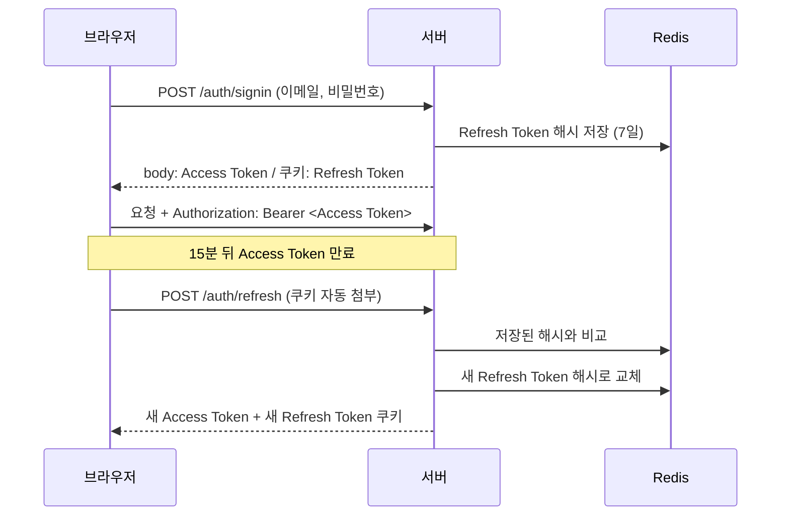

# 인증: JWT와 Refresh Token

## 전체 흐름

## 1. 세션 대신 JWT, 하지만 Refresh Token은 서버에 둔다

**상황**
세션(session) 방식은 로그인 상태를 서버 메모리나 저장소에 두고, 브라우저에는 세션 ID 쿠키만 줍니다. 단순하지만 요청마다 저장소를 조회해야 합니다. JWT는 토큰 자체에 사용자 정보와 서명이 있어 조회가 필요 없지만, 한 번 발급하면 **만료 전에 강제로 무효화할 수 없습니다.**

**선택**
두 방식을 섞었습니다.

| 토큰 | 수명 | 전달 방식 | 서버 저장 |
| --- | --- | --- | --- |
| Access Token | 15분 | 응답 body → 프론트 메모리 | 저장 안 함 (stateless) |
| Refresh Token | 7일 | `httpOnly` 쿠키 | Redis에 해시로 저장 |

**이유**
- 대부분의 요청은 Access Token 서명만 검증하므로 저장소 조회가 없습니다.
- Access Token은 탈취되면 그대로 쓰일 수 있어 수명을 15분으로 짧게 둡니다.
- Refresh Token은 서버(Redis)에 있어서 로그아웃하면 지울 수 있습니다. 세션처럼 무효화가 가능한 부분은 여기에만 둡니다.

**코드**
- `src/auth/auth.service.ts`의 `getTokens()`: 두 토큰을 서로 다른 시크릿(`JWT_ACCESS_SECRET`, `JWT_REFRESH_SECRET`)으로 서명합니다. 시크릿이 다르면 Refresh Token을 Access Token 자리에 넣어도 검증에 실패합니다.
- 그래서 `JwtModule.register({})`에는 기본 시크릿을 두지 않고, 서명할 때마다 시크릿을 넘깁니다 (`src/auth/auth.module.ts`).

## 2. Refresh Token은 httpOnly 쿠키로

**상황**
Refresh Token을 Access Token처럼 body로 주면 프론트가 어딘가(localStorage 등)에 저장해야 하고, XSS(스크립트 삽입 공격)로 읽힐 수 있습니다.

**선택**
- Refresh Token: `httpOnly` 쿠키. JavaScript에서 읽을 수 없고, 브라우저가 요청에 자동으로 붙입니다.
- Access Token: body로 주고 프론트는 메모리(변수)에만 둡니다. 새로고침하면 사라지지만 Refresh Token으로 바로 다시 받습니다.
- 쿠키 `path`를 `/auth/refresh`로 좁혀, 이 쿠키가 다른 API 요청에는 실리지 않게 했습니다.
- 운영 환경(`NODE_ENV=production`)에서는 `secure` 플래그로 HTTPS에서만 전송합니다.

**코드**
- `src/auth/auth.controller.ts`의 `setRefreshTokenCookie()`: 회원가입, 로그인, 갱신에서 쓰는 쿠키 설정을 한곳에 모았습니다.
- `src/auth/guard/refresh-token.guard.ts`: 헤더가 아니라 `request.cookies.refreshToken`에서 토큰을 꺼냅니다.

**남은 과제**
- `maxAge: 60 * 60 * 24 * 7`은 초 단위로 쓴 값인데, Express의 `res.cookie()`는 **밀리초(ms)** 단위입니다. 그래서 실제 쿠키 수명은 7일이 아니라 약 10분입니다. Redis TTL(7일)과 맞추려면 `* 1000`이 필요합니다.

## 3. Refresh Token 저장소로 Redis

**상황**
Refresh Token을 서버에 저장하기로 했으니 어디에 둘지 정해야 했습니다. 후보는 MySQL 테이블과 Redis(인메모리 캐시)였습니다.

**선택**
Redis. `@nestjs/cache-manager` + `@keyv/redis`로 붙였습니다.

**이유**
- 로그인과 토큰 갱신마다 읽고 쓰는 데이터라 빠른 읽기·쓰기가 중요합니다.
- TTL(만료 시간)을 7일로 걸어 두면 만료된 토큰이 자동으로 지워집니다. MySQL이라면 지우는 작업을 따로 만들어야 합니다.
- 영구 보관할 필요가 없는 임시 데이터라 메인 DB에 부하를 주지 않는 편이 낫습니다.

**코드**
- `src/auth/auth.service.ts`의 `updateRefreshTokenInCache()`: 키는 `userId`, 값은 Refresh Token의 **해시**, TTL은 7일입니다.

## 4. Refresh Token을 해시로 저장하고, 쓸 때마다 교체

**상황**
Redis가 유출되면 저장된 Refresh Token으로 바로 로그인할 수 있습니다. 또 Refresh Token 하나를 7일 내내 쓰면 탈취됐을 때 피해 기간이 깁니다.

**선택**
- 저장할 때 Argon2로 해시해서 저장하고, 비교할 때 `verify()`로 확인합니다. 비밀번호와 같은 방식입니다.
- `/auth/refresh`를 호출하면 Access Token과 Refresh Token을 **둘 다 새로 발급**하고 Redis 값도 교체합니다. 이를 Refresh Token Rotation(로테이션)이라고 합니다. 이전 Refresh Token은 더 이상 Redis 값과 맞지 않아 쓸 수 없습니다.
- 로그아웃(`GET /auth/signout`)은 Redis에서 해당 유저의 값을 지웁니다. 서버는 브라우저의 Access Token을 지울 수 없으니, 서버가 할 수 있는 일은 Refresh Token을 무효화하는 것입니다.

**코드**
- `src/auth/auth.service.ts`의 `refreshAllTokens()`, `logout()`

**남은 과제**
- 키가 `userId` 하나라서, 한 유저가 여러 기기에서 로그인하면 마지막 기기의 Refresh Token만 살아남습니다.
- 로그아웃이 Redis 값만 지우고 쿠키는 지우지 않습니다. 다음 갱신 요청은 403으로 막히므로 로그아웃 자체는 유지됩니다.

## 5. 비밀번호 해싱은 Argon2

**선택**
`argon2` 패키지의 `hash()`, `verify()`를 씁니다. 해시 문자열 안에 솔트(salt)와 설정값이 함께 들어 있어서 따로 저장할 필요가 없습니다.

**이유**
Argon2는 비밀번호 해싱 공모전(Password Hashing Competition) 우승 알고리즘이고, 메모리를 많이 쓰도록 설계돼 GPU로 대량 대입하기 어렵습니다. bcrypt도 널리 쓰이지만, 새로 고른다면 Argon2가 권장되는 편입니다.

**코드**
- `src/auth/auth.service.ts`의 `signUp()`, `signIn()`

## 6. 가드(Guard)와 `@User()` 데코레이터

**상황**
NestJS에서 인증은 가드가 맡습니다. 가드가 토큰을 검증한 뒤 `request['user']`에 페이로드(payload)를 넣는데, Express의 `Request` 타입에는 `user`가 없어서 컨트롤러에서 꺼낼 때 타입이 `any`가 됩니다.

**선택**
검토한 방법은 세 가지였습니다.

1. Express의 `Request` 타입 전체를 확장(declaration merging)
2. 커스텀 Request 타입을 직접 선언해 매번 지정
3. **커스텀 파라미터 데코레이터 `@User()`를 만들어 타입을 고정** ← 선택

**이유**
전역 타입을 건드리지 않고, 컨트롤러에서는 `@User('sub') userId: string`처럼 필요한 값만 타입이 붙은 채로 받을 수 있습니다. 페이로드 구조는 `JwtPayload` 인터페이스(`sub`, `email`, `name`) 하나로 정의했습니다.

**코드**
- `src/auth/guard/access-token.guard.ts`: `Authorization: Bearer <토큰>` 헤더 검증
- `src/auth/guard/refresh-token.guard.ts`: 쿠키 검증
- `src/auth/decorator/user.decorator.ts`, `src/auth/types/jwt-payload.ts`

**현재 코드와 다른 점**
Nest 12 템플릿은 TypeScript `strict` 모드라, 가드 안의 `request['user'] = payload` 한 줄이 그대로는 타입 에러가 납니다. 가드의 `getRequest<Request & { user?: JwtPayload }>()` 타입만 넓혀서 해결했습니다.

**남은 과제**
- 회원가입·로그인 DTO에 `class-validator` 데코레이터(`@IsEmail()` 등)는 달려 있지만, 인증 컨트롤러에 `ValidationPipe`를 걸지 않아 실제로는 검증되지 않습니다. 지금은 프론트의 입력 검증에만 기대고 있습니다.
