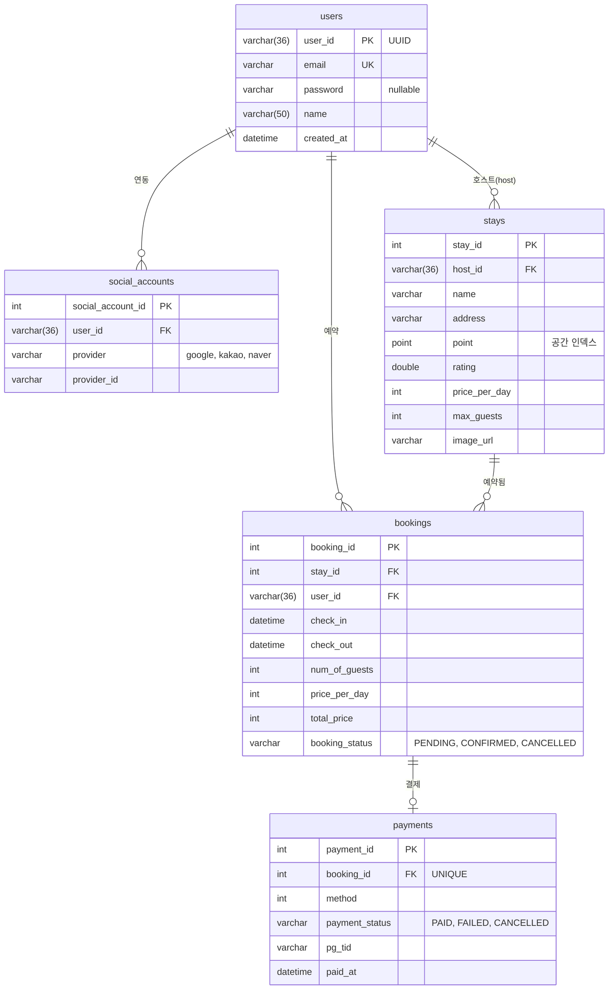

# 데이터 모델

## ERD

엔티티 파일: `src/user/user.entity.ts`, `src/social_account/social_account.entity.ts`, `src/stay/stay.entity.ts`, `src/booking/booking.entity.ts`, `src/payment/payment.entity.ts`

## 1. 소셜 로그인을 고려한 유저 설계

**상황**
일반 로그인(이메일 + 비밀번호)과 소셜 로그인(구글, 카카오, 네이버)을 함께 지원하려고 했습니다. 소셜 로그인 유저는 비밀번호가 없습니다.

**선택**
- `users.password`를 **nullable**로 둡니다. 일반 회원가입에서는 애플리케이션 코드가 비밀번호를 필수로 받습니다.
- 소셜 계정은 별도 테이블 `social_accounts`에 두고 `users`와 1:N(일대다)으로 연결합니다. 한 유저가 여러 소셜 계정을 연동할 수 있습니다.
- `(user_id, provider)` 복합 유니크(unique) 제약: 한 유저가 같은 provider를 두 번 연동하지 못합니다.
- 유저가 삭제되면 소셜 계정도 함께 지워지도록 `ON DELETE CASCADE`를 걸었습니다.

**이유**
`users`에 `google_id`, `kakao_id` 같은 컬럼을 늘리면 provider가 추가될 때마다 스키마를 바꿔야 합니다. 별도 테이블이면 행만 추가하면 됩니다.

**코드**
- `src/auth/auth.service.ts`의 `signIn()`: `password`가 없는 계정(소셜 가입)은 비밀번호 로그인을 막습니다.

**남은 과제**
- 소셜 로그인 자체는 아직 구현하지 않았습니다.
- 소셜 로그인을 붙이면 "이 provider의 이 사용자는 누구인가"로 조회하게 됩니다. 이메일은 provider마다 정책이 달라 겹칠 수 있으므로, 이때 쓸 `(provider, provider_id)` 유니크 제약도 추가해야 합니다.

## 2. PK: 유저는 UUID, 나머지는 auto-increment

**상황**
기본 키(PK)를 순차 숫자(auto-increment)로 할지 UUID로 할지 정해야 했습니다.

**선택**
- `users.user_id`: UUID
- `stays`, `bookings`, `payments`, `social_accounts`: auto-increment 정수

**이유**
유저 ID는 URL이나 토큰(JWT의 `sub`)으로 외부에 나갈 수 있습니다. 순차 숫자면 `/users/1`, `/users/2`처럼 다른 유저를 추측하기 쉽고, 전체 유저 수도 드러납니다. UUID는 추측할 수 없습니다.
나머지 테이블은 외부에 ID가 노출돼도 문제가 작고, 정수 PK가 인덱스 크기와 정렬 면에서 유리해서 auto-increment로 두었습니다.

**대안**
내부 PK는 auto-increment로 두고, 외부에 보여줄 값만 별도 UUID 컬럼(public id)으로 두는 방식도 많이 씁니다. 인덱스 효율과 추측 방지를 둘 다 챙길 수 있습니다.

## 3. 상태 값은 DB ENUM 대신 varchar + TypeScript 유니온 타입

**상황**
예약 상태(`PENDING`, `CONFIRMED`, `CANCELLED`)나 결제 상태처럼 정해진 값만 들어가는 컬럼이 있습니다.

**선택**
- DB: `varchar(50)`
- 코드: TypeScript 유니온 타입 `'PENDING' | 'CONFIRMED' | 'CANCELLED'`

**이유**
- MySQL `ENUM`은 값을 추가할 때(예: `REFUNDED`) `ALTER TABLE`이 필요해 스키마 변경이 무겁습니다.
- TypeScript의 `enum`은 컴파일 후에도 실제 객체 코드로 남습니다. 유니온 타입은 타입 검사에만 쓰이고 사라집니다.

**트레이드오프**
DB가 값을 막아 주지 않으므로, 잘못된 값이 들어가지 않게 하는 책임이 애플리케이션에 있습니다. DB에서도 막고 싶다면 `CHECK` 제약이나 상태 코드 테이블(FK)을 둘 수 있습니다.

## 4. 이름 규칙: DB는 snake_case, 코드는 camelCase

**선택**
- 테이블 이름은 복수형 snake_case: `users`, `social_accounts`
- 컬럼 이름은 snake_case, 엔티티 프로퍼티는 camelCase로 두고 `@Column({ name: 'price_per_day' })`처럼 매핑합니다.
- PK 컬럼도 `id`가 아니라 `user_id`, `stay_id`처럼 테이블 이름을 붙였습니다.

**이유**
SQL에서는 대소문자를 구분하지 않는 환경이 많아 snake_case가 관례이고, TypeScript에서는 camelCase가 관례입니다. 매핑을 엔티티 한곳에 모아 양쪽 관례를 지킵니다. PK에 테이블 이름을 붙이면 조인 쿼리에서 어느 테이블의 ID인지 바로 보입니다.

## 5. 예약과 결제

**선택**
- 예약 시점의 1박 요금(`price_per_day`)과 총액(`total_price`)을 예약 행에 따로 저장합니다. 나중에 스테이 요금이 바뀌어도 이미 한 예약의 금액은 바뀌지 않아야 하기 때문입니다.
- 결제는 예약과 1:1이고, `payments.booking_id`에 유니크 제약을 걸어 한 예약에 결제가 두 번 생기지 않게 했습니다.
- `pg_tid`: 결제 대행사(PG, Payment Gateway)가 주는 거래 ID입니다. 환불이나 대사(정산 대조) 때 필요합니다.
- 같은 스테이의 같은 체크인·체크아웃 예약이 두 번 생기지 않도록 `(stay_id, check_in, check_out)` 복합 유니크 제약을 걸었습니다.

**남은 과제**
- 복합 유니크는 **날짜가 정확히 같은 예약**만 막습니다. 1일~3일 예약이 있을 때 2일~4일 예약은 막지 못합니다. 겹치는 기간까지 막으려면 예약 생성 시 트랜잭션 안에서 기간 겹침을 조회하거나(행 잠금 포함), 날짜별 재고 테이블을 두는 방식이 필요합니다.
- 예약·결제 API는 아직 없고 엔티티와 테이블만 있습니다.
